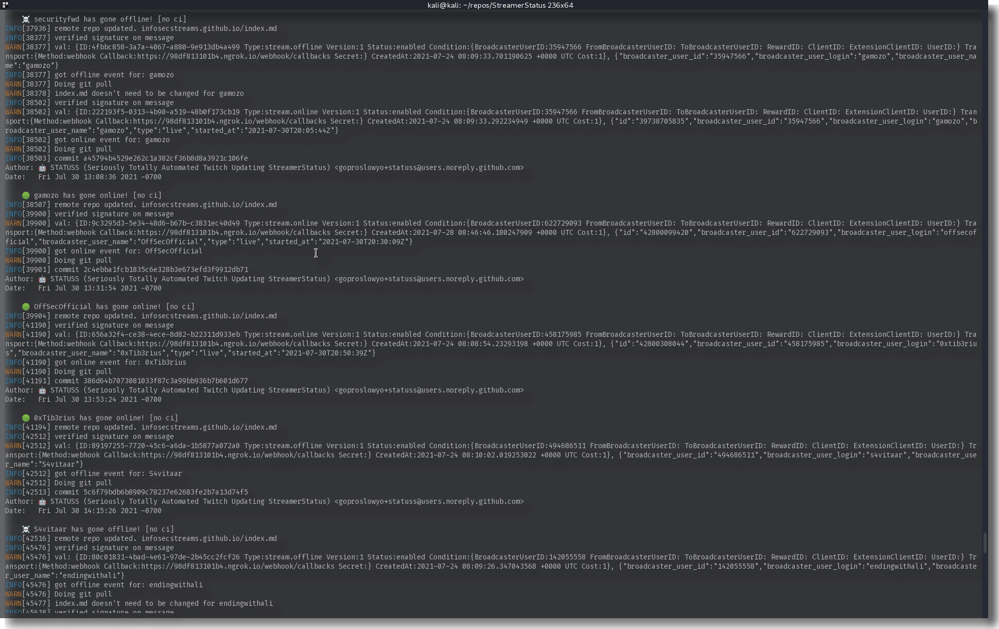

# StreamStatus

This program updates streamer's status on the [hacklist](https://infosecstreams.github.io/) by receiving Twitch EventSub webhook requests, editing the repo markdown, and committing the changes back to GitHub.



You need `stream.online`, `stream.offline` and `channel.update` subscriptions from the Twitch EventSub API (set `SS_CALLBACK_URL` and the bot creates any that are missing). `channel.update` drives the 🟡 "getting ready" marker shown when an offline streamer switches to an infosec category. This program listens on `http://0.0.0.0:SS_PORT/webhook/callbacks` for webhook requests from twitch containing JSON EventSub data:

```json
{
  "subscription": {
    "id": "607e9634-8600-450c-948e-8cc1380fa9fe",
    "status": "enabled",
    "type": "stream.offline",
    "version": "1",
    "condition": { "broadcaster_user_id": "555942272" },
    "transport": {
      "method": "webhook",
      "callback": "https://98cf813101b4.ngrok.io/webhook/callbacks"
    },
    "created_at": "2021-07-24T08:09:34.816454134Z",
    "cost": 1
  },
  "event": {
    "broadcaster_user_id": "555942272",
    "broadcaster_user_login": "goproslowyo",
    "broadcaster_user_name": "GoProSlowYo"
  }
}
```

Since Twitch removed "Hack the Box" and "TryHackMe" as categories we just look for various Cybersecurity related tags to guess if it's content we want to show as "online".

This is the current list of games and (optional) tags in the code:

```golang
var VALID_GAMES = []string{
  "just chatting",
  "science \u0026 technology",
  "software and game development",
  "talk shows \u0026 podcasts",
}

var OPTIONAL_TAGS = []string{
  "ctf", "capturetheflag",
  "htb", "hackthebox",
  "thm", "tryhackme",
  "infosec", "cybersecurity", "informationsecurity",
  "hacker", "hacking", "bugbounty", "pentest", "security",
  "reverseengineering", "malware", "malwareanalysis",
  "iss", "infosecstream", "infosecstreams", "infosecstreamer", "infosecstreamers",
}
```

The code is ~~bad~~ okay-ish and I feel ~~bad~~ okay-ish.

## Build It

Directly with go:

```shell
go mod tidy
go build -mod vendor -ldflags="-s -w" -o StreamStatus ./...
```

---

Or, build a docker image:

```shell
make build-ss
# or
docker build -t streamstatus:dev .
```

## Use It

1. Update the env vars in streamstatus.env for docker-compose (check streamstatus.env.example).
1. Run it in docker:

```shell
$ make ss-run
INFO[0000] server starting on :8080
```

Run directly with ENV vars:

```shell
SS_PORT=3000 SS_SECRETKEY=secret SS_TOKEN=token SS_USERNAME=username TW_CLIENT_ID=client_id TW_CLIENT_SECRET=client_secret ./StreamStatus
```

---

Or, export required ENV vars:

```shell
# Port to listen on
export SS_PORT=3000
# Secret key to HMAC EventSub message
export SS_SECRETKEY=secret
# GitHub access to the site repo, either a GitHub App (preferred; the bot mints
# and refreshes 1-hour installation tokens limited to the site repo):
export SS_GH_APP_ID=123456                # App ID (or the App's client ID)
export SS_GH_APP_INSTALLATION_ID=12345678 # from the App's installation URL
export SS_GH_APP_PRIVATE_KEY_PATH=/run/secrets/streamstatus-github-app.pem
# ...or, when the three SS_GH_APP_* are unset, a personal access token:
export SS_TOKEN=token
export SS_USERNAME=username
# Twitch Client ID
export TW_CLIENT_ID=client_id
# Twitch Secret
export TW_CLIENT_SECRET=client_secret
# Optional: Discord channel webhook for errors and status alerts (keep it secret)
export SS_DISCORD_WEBHOOK=https://discord.com/api/webhooks/<id>/<token>
# Optional: public URL of /webhook/callbacks; when set the bot creates any missing
# stream.online, stream.offline and channel.update EventSub subscriptions
export SS_CALLBACK_URL=https://example.com/webhook/callbacks
# Optional: how often to re-check every streamer's live state against Helix (default 5m)
export SS_RECONCILE_INTERVAL=5m
# Optional: let reconciliation reactivate live streamers from inactive_streamers.csv (default false)
export SS_RECONCILE_INACTIVE=false

# Run:
./StreamStatus
```

---

Or, if you built the docker image:

```shell
docker run --rm -it -e SS_PORT=9001 -e SS_SECRETKEY=secret -e SS_TOKEN=token -e SS_USERNAME=username -e TW_CLIENT_ID=client_id -e TW_CLIENT_SECRET=client_secret streamstatus:dev
```

---

Or, use `docker-compose` after setting environment variables in `streamstatus.env`

```shell
docker-compose --build up
# or to background it:
docker-compose --build up -d
```

## Releases and deploys

Push a `vX.Y.Z` tag. CI tests, builds, signs (keyless cosign + build provenance) and deploys the
exact digest to production with automatic rollback. See [deploy/README.md](deploy/README.md) for
how it works, the one-time host/GitHub setup and how to test a deploy safely, and
[deploy/GITHUB_APP.md](deploy/GITHUB_APP.md) for creating the GitHub App the bot pushes as.

